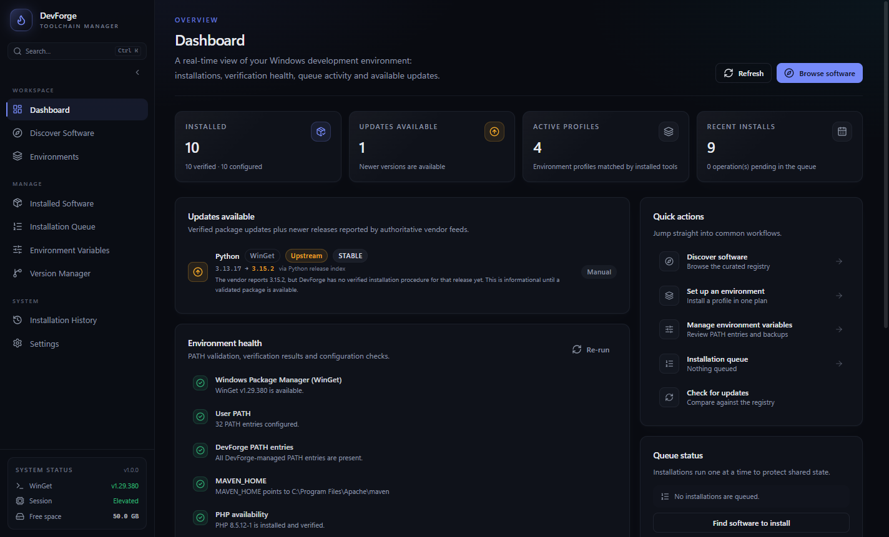
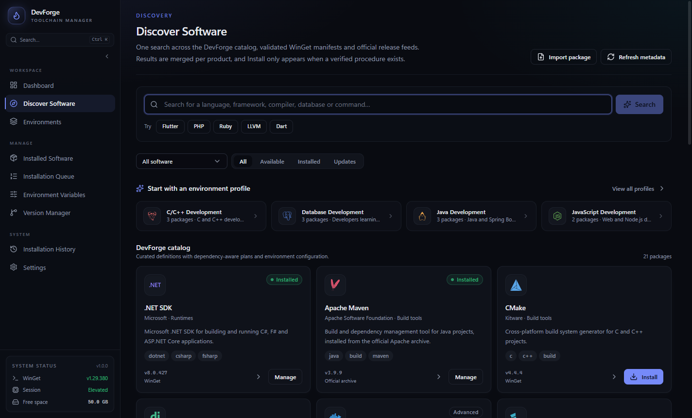
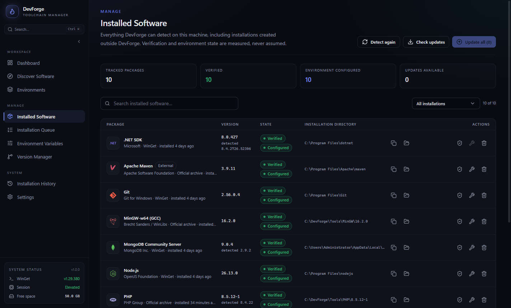

# DevForge

### Development environments, forged in one place.

DevForge is a Windows desktop application that installs, verifies, configures, updates and removes the tools you need to build software — languages, runtimes, frameworks, compilers, databases and developer utilities — from one validated, trustworthy catalogue.

No more hunting through vendor websites. No more guessing which installer is current. No more editing `PATH` by hand and hoping. Search for a tool, review a real plan, and let DevForge do the work while showing you exactly what happened.

<p align="center">
  
</p>

<p align="center">
  <a href="https://github.com/sajidullahkhan08/DevForge/actions/workflows/ci.yml"></a>
  <a href="https://github.com/sajidullahkhan08/DevForge/actions/workflows/release.yml"></a>
  <a href="https://github.com/sajidullahkhan08/DevForge/releases/latest"></a>
  <a href="LICENSE"></a>
  
</p>

---

## Download

Get the latest Windows installer from the [**Releases page**](https://github.com/sajidullahkhan08/DevForge/releases/latest).

| File | What it is |
| --- | --- |
| `DevForge-Setup-<version>.exe` | Per-user NSIS installer. Lets you choose the installation folder and can request elevation for the operations that need it. |
| `SHA256SUMS.txt` | SHA-256 checksums for every downloadable asset in the release. |
| `sbom.cdx.json` | CycloneDX software bill of materials for the release build. |

**Install:** download the setup file, run it, and follow the wizard. DevForge is installed for the current user and does **not** require administrator rights to start. Windows will ask for approval only when you choose an operation that genuinely needs it, such as a machine-wide `PATH` change.

> **SmartScreen.** The installer is currently unsigned, so Windows may show a "Windows protected your PC" prompt. Choose **More info → Run anyway** if you trust the download. You can verify the file first with the checksum below.

Verify a downloaded installer in PowerShell:

```powershell
Get-FileHash .\DevForge-Setup-1.0.0.exe -Algorithm SHA256
# Compare the result with the matching line in SHA256SUMS.txt from the release.
```

---

## Screens

<p align="center">
  
</p>

<p align="center"><em>Dashboard — real installations, verification health, updates and queue state.</em></p>

<p align="center">
  
</p>

<p align="center"><em>Discover Software — one ranked result per product, with validated install actions.</em></p>

<p align="center">
  
</p>

<p align="center"><em>Installed Software — every package detected, verified and accounted for.</em></p>

---

## Why DevForge exists

Setting up a development machine is one of the first walls a new developer hits. It is rarely the code that stops them — it is everything around it:

- Which version of Python, Java or Node.js should I install?
- Why does `python` work in one terminal and not another?
- Why does `npm` say it is not installed when it clearly is?
- Which download is official, and which is an ad-wrapped mirror?
- Why did installing one tool silently break another?
- How do I get the same environment on my second machine?

DevForge treats environment setup as an engineering problem instead of a ritual. Every package is defined as data, every operation is checked before it runs, every result is verified afterwards, and every change to your system is recorded and reversible.

The full origin story — why this project exists and how it was built — is in [**STORY.md**](STORY.md).

---

## What DevForge does

### One search for everything

Type a product name, a command, or a package id — `Node.js`, `python`, `gcc`, `mongodb`, `flutter`, `composer` — and DevForge resolves it to a single canonical identity. The search merges three sources:

1. the curated catalogue shipped with the app,
2. validated WinGet manifests,
3. authoritative vendor release feeds and official repositories.

Every product appears **once**, ranked by how exactly the query matches and how trustworthy the source is. Versions carry their provenance, so you can see whether a number came from a vendor feed, a release page or a WinGet manifest. If a refresh fails, cached data is clearly marked as stale rather than presented as current.

### Only real, validated installs

A result never gets an Install button merely because it appeared in a search. DevForge must be able to map it to a validated WinGet manifest or an official HTTPS archive with a published SHA-256 checksum. Premium or preview archives that cannot be verified are never offered as installable.

There are four installation methods:

| Method | Used for |
| --- | --- |
| **WinGet** | Packages with a validated manifest, installed through the system package manager. |
| **Verified archive** | Official ZIP downloads, streamed, hashed and checked before extraction. |
| **Official installer** | Vendor installers, optionally pinned to an expected Authenticode publisher and thumbprint. |
| **Project recipe** | Instructions for tools that should be configured manually. DevForge shows them and never executes them. |

### Plans before actions

Before a single byte is downloaded, DevForge builds an installation plan: required dependencies, selected versions, topological order, cycle detection, architecture compatibility, free disk space, elevation requirements and WinGet availability. You see the plan; then you approve it.

Dependencies are installed in the right order, and one installation runs at a time in a serialized queue. The queue survives a restart, supports cancellation, retry and reordering, and reports real stages with elapsed time and an estimate — never a decorative progress bar.

### Honest verification

A package is marked installed only after the operation actually ran, the result was verified, and the transaction was recorded. Verification can use:

- the real command and its output (with `PATH` and `PATHEXT` resolution, so Windows shims such as `npm.cmd` work correctly),
- known installation folders,
- Windows uninstall registry entries,
- Windows services,
- WinGet package listings.

Detection prefers fresh evidence over old records. If a newer version is already on the machine, the stale number is replaced rather than reported forever.

### Updates with context

Installed versions are compared with the catalogue and, when enabled, the product's authoritative vendor feed. If an update exists upstream but DevForge has no verified procedure for it, the update is labelled **informational** instead of exposing an unsafe install button. When an update is available, the badge disappears as soon as the newer version is genuinely installed.

### Environments you own

DevForge manages `PATH` and environment variables with care:

- unrelated entries are preserved,
- values are normalized and de-duplicated,
- every change is backed up before it is written,
- changes can be reversed individually instead of restoring a whole snapshot,
- correct entries count as success, so retries are idempotent and only apply what is missing.

The **Environment Doctor** finds duplicate `PATH` entries, missing managed folders and stale `JAVA_HOME`, `MAVEN_HOME` or `GOROOT` values, then offers targeted fixes with a preview.

### Reproducible setups and per-project pinning

Export your environment as a portable, version-pinned manifest and import it on another machine. Pin exact installed runtimes to a single project by generating `.devforge\activate.ps1`, which changes only that terminal session — your machine-wide `PATH` stays untouched.

### A window into the whole machine

The dashboard is built from real records: installations, verification runs, backup history and transactions. Nine sections cover the full lifecycle:

**Dashboard** · **Discover Software** · **Development Environments** · **Installed Software** · **Installation Queue** · **Environment Variables** · **Version Manager** · **Installation History** · **Settings**

A `Ctrl+K` command palette, focusable main region, skip link, tray controls, resume-on-startup and desktop notifications keep the app out of your way.

### Built to be trusted

- Sandboxed renderer, `contextIsolation` on, `nodeIntegration` off.
- Every IPC payload validated with zod; the sender window is verified.
- No arbitrary shell execution — commands and arguments come from validated definitions or fixed internal code paths.
- HTTPS-only downloads with mandatory checksum verification.
- Archive extraction confined to a staging directory; traversal, symlinks, encrypted entries and duplicate targets are rejected.
- SQLite, logs and diagnostics stay local. No account, no telemetry, no bundled SDK archives.
- Optional HTTP/HTTPS proxy with a bypass list, applied to downloads, release lookups and child installers.

Read the full model in [Security](docs/SECURITY.md).

---

## How it works

```
              ┌──────────────────────────────────────────────┐
              │                Renderer (React)              │
              │  search · plans · queue · history · settings │
              └──────────────────────┬───────────────────────┘
                                     │ typed, validated IPC
              ┌──────────────────────▼───────────────────────┐
              │             Electron main process            │
              │                                              │
              │  Discovery ──► Identity ──► Version resolver  │
              │       │            │              │          │
              │       ▼            ▼              ▼          │
              │   Catalogue     WinGet       Vendor feeds    │
              │       └────────────┬─────────────┘            │
              │                    ▼                          │
              │              Dependency planner               │
              │                    ▼                          │
              │          Serialized installation queue        │
              │                    ▼                          │
              │   Downloader → checksum → extract → install   │
              │                    ▼                          │
              │        Verification · Environment · Records   │
              └──────────────────────────────────────────────┘
```

The renderer never touches the system. It asks the main process to search, plan, install, verify or configure, and the main process answers with validated data. This boundary is the reason DevForge can show real state instead of guessing.

Deeper reading:

- [Architecture](docs/ARCHITECTURE.md) — processes, services and data flow.
- [Unified Discovery and Version Resolution](docs/DISCOVERY_AND_VERSIONS.md) — identity, ranking and provenance.
- [Installation Engine](docs/INSTALLATION_ENGINE.md) — plans, queue, downloads, verification and updates.

---

## Supported software

The curated catalogue ships with **20 packages** across seven categories. Discovery can additionally prepare validated WinGet and official-archive packages at runtime.

| Category | Packages |
| --- | --- |
| Languages | Python, Node.js, Java (OpenJDK), Go, Rust |
| Runtimes | .NET SDK |
| Frameworks | React + Vite, Django, Flask, Spring Boot |
| Databases | PostgreSQL, MySQL, MongoDB |
| Compilers | MinGW-w64 |
| Build tools | CMake, Apache Maven |
| Developer tools | Git, GitHub CLI, Docker Desktop, Windows Terminal |

**Built-in profiles:** Python, JavaScript, Web, MERN, Java, C/C++ and Database development.

Every curated package uses official HTTPS sources and publishes SHA-256 or SHA-512 checksums for archived downloads. The catalogue contains metadata only — no installers, SDK archives or discovery caches are bundled into the application.

Want to add a package? See [Package Development](docs/PACKAGE_DEVELOPMENT.md). For a one-off tool, use **Discover Software** and DevForge will prepare a validated WinGet or official-archive definition at runtime.

---

## Requirements

| | |
| --- | --- |
| **Operating system** | Windows 10 or Windows 11, x64 |
| **For WinGet packages** | [WinGet](https://learn.microsoft.com/windows/package-manager/) installed and available on `PATH`. WinGet also contributes validated manifests to discovery. |
| **Network** | Internet access for downloads, WinGet operations, live discovery and version checks (nodejs.org, python.org, go.dev, windows.php.net, Google storage and the GitHub Releases API). The curated catalogue and existing installations keep working offline. |
| **Elevation** | Only for operations that need it: system-scope installs, system `PATH` changes and machine-level variables. |
| **Building from source** | Node.js 22 or newer (24 recommended). |

---

## Run from source

```bash
git clone https://github.com/sajidullahkhan08/DevForge.git
cd DevForge
npm install
npm run dev
```

`npm run dev` starts Electron with Vite hot reload for the renderer.

### Production build and installer

```bash
npm run build        # typecheck, then bundle main, preload and renderer into out/
npm run start        # run the production bundles
npm run package      # NSIS installer in dist/
npm run package:dir  # unpacked application in dist/win-unpacked
```

### Every script

| Script | Purpose |
| --- | --- |
| `npm run dev` | Start Electron with Vite HMR |
| `npm run build` | Typecheck both TypeScript projects and produce `out/` |
| `npm run start` | Preview the production bundles |
| `npm run typecheck` | Typecheck main/preload/shared and renderer |
| `npm test` | Vitest unit and integration suite |
| `npm run test:watch` | Run tests in watch mode |
| `npm run test:e2e` | Build, then run Playwright Electron smoke tests |
| `npm run verify` | Typecheck, tests and production build in one command |
| `npm run audit:prod` | Fail on high-severity advisories in production dependencies |
| `npm run sbom` | Write a CycloneDX 1.5 SBOM to `dist/sbom.cdx.json` |
| `npm run package` | Build the NSIS installer for Windows x64 |
| `npm run package:dir` | Build an unpacked application directory |

---

## Project structure

```
electron/
  main/
    index.ts              application lifecycle and window wiring
    window.ts             hardened BrowserWindow
    tray.ts               optional tray icon, queue controls and quit
    ipc.ts                typed IPC handlers with zod validation
    context.ts            service composition root
    services/
      registry/           curated registry loading and validation
      identities/         canonical identities and package mapping
      releases/           vendor release providers, parsers, cache, provenance
      discovery/          identity-aware search, ranking, dedupe, persistence
      planner/            pure dependency planner and planner service
      install/            installation engine, serialized queue, persisted state
      download/           streaming HTTPS downloads, checksums, proxy transport
      detection/          detection and verification engines
      environment/        PATH and variable management, doctor, templates
      projects/           per-project runtime pinning and activation scripts
      database/           SQLite schema, migrations and repositories
      catalogue/          merged catalogue view and update badges
      profiles/           environment profiles
      dashboard/          dashboard aggregation
      logging/            structured logging
      process/            command execution and shim resolution
      system/             Windows-specific system access
  preload/index.ts        contextBridge API
shared/                   types, IPC channels, schemas, manifests, helpers
src/                      React renderer: pages, components, hooks, store
packages/
  registry/               package definitions grouped by category
  profiles/               built-in environment profiles
  identities.json         canonical software identities
scripts/                  SBOM generation
tests/                    Vitest unit tests and Playwright Electron tests
docs/                     architecture, engine, package, security, user and test docs
.github/workflows/        CI and release packaging
```

---

## Testing

DevForge is verified with a Vitest unit and integration suite plus Playwright Electron smoke tests, including a packaged-build test.

```bash
npm run verify      # typecheck + unit tests + production build
npm run test:e2e    # rebuild and run the Electron end-to-end suite
npm run audit:prod  # production dependency audit
npm run sbom        # regenerate the software bill of materials
```

CI runs the same checks on Windows for every push and pull request. See [Testing](docs/TESTING.md) for the suite layout and what each test covers.

---

## Documentation

| Document | Contents |
| --- | --- |
| [STORY.md](STORY.md) | The problem, the motivation and the story behind DevForge |
| [User Guide](docs/USER_GUIDE.md) | A tour of every screen and workflow |
| [Architecture](docs/ARCHITECTURE.md) | Process model, services and data flow |
| [Unified Discovery and Version Resolution](docs/DISCOVERY_AND_VERSIONS.md) | Identity, ranking, provenance and caching |
| [Installation Engine](docs/INSTALLATION_ENGINE.md) | Plans, queue, downloads, installation and verification |
| [Package Development](docs/PACKAGE_DEVELOPMENT.md) | How to add a curated package |
| [Security](docs/SECURITY.md) | Threat model, trust boundaries and safeguards |
| [Testing](docs/TESTING.md) | Test strategy and suite reference |
| [Contributing](CONTRIBUTING.md) | Development setup and contribution rules |
| [Changelog](CHANGELOG.md) | Release history |

---

## Contributing

Issues and pull requests are welcome. Please read [CONTRIBUTING.md](CONTRIBUTING.md) first, and report security problems privately as described in [SECURITY.md](SECURITY.md).

## Licence

DevForge is released under the [MIT Licence](LICENSE). Copyright © 2026 Sajidullah Khan.
